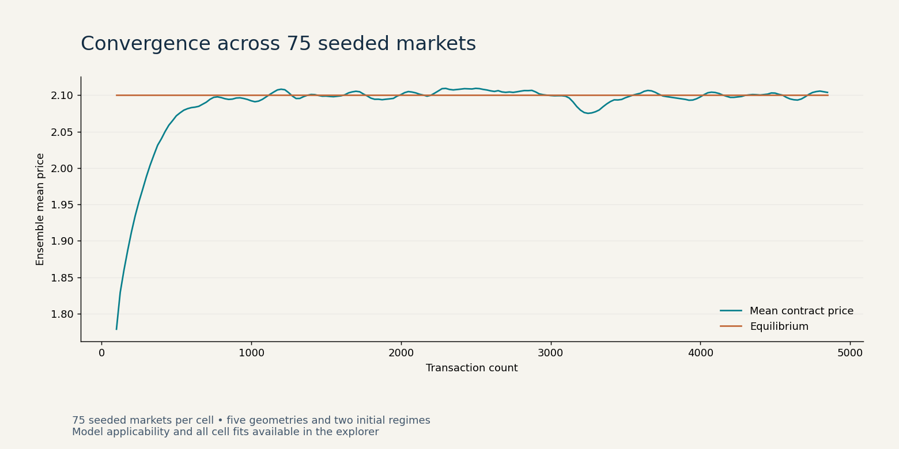

# The Physics in Economics

## Project visualization



[Open the interactive explorer](docs/explorer.html) — download and open this self-contained HTML in a browser. GitHub displays the source rather than running it. The explorer reads embedded audited results; full evidence and reproduction commands are below.


**First-order relaxation, continuous double auctions, and the limits of a mechanical market analogy.**

By Aarush Shah. This repository accompanies the [paper](paper/The_Physics_in_Economics.pdf), preserves the [upstream source attribution](docs/UPSTREAM.md), and adds a reproducibility audit. The original paper is unchanged; corrections are documented in [AUDIT.md](docs/AUDIT.md).


## Verified findings

| Experiment | Fresh verification |
|---|---|
| Smith Test 1, 28 digitized observations | Time constant 5.16585; R-squared 0.561401; 25/28 within 5% relative error |
| CDA Monte Carlo | 5 environments x 2 initial regimes x 75 seeds = 750 simulations |
| Terminal offset | Maximum absolute cell-mean last-500 offset: 0.8653% of equilibrium |
| Sampled crossed books | 0; sampling is not a complete event audit |
| Nonlinear surplus exponential fit | R-squared -3.9708; the model does not fit every geometry/regime |

The Smith exercise is an in-sample fit to the paper's digitization, not an out-of-sample prediction or recreation of the original human market. The CDA results are fresh seeded replications, not the original paper's unrecovered random streams.

## Reproduce

```bash
python -m pip install -r requirements.txt
python verify.py
python run_mc.py --n-seeds 75
python analyze.py
python plot.py
```

Run analysis only after Monte Carlo finishes. Use a fresh `results/` directory when changing seed counts: the upstream analysis discovers files, so leftover seeds can otherwise contaminate a smaller rerun. All commands are local.

`run_mc.py` now uses deterministic SHA-256 seed derivation and float64 storage. The simulation itself is preserved. `analyze.py` retains the original fixed 250-transaction cutoff and exploratory decomposition so discrepancies with the paper remain inspectable.

## Project map

- `cda.py`, `environments.py`: auction mechanism and five supply/demand environments.
- `run_mc.py`, `analyze.py`, `plot.py`: simulation, analysis, and original plots.
- `verify.py`: independent Smith refit, equilibrium roots, and seed checks.
- `results/runs/`: all 750 raw simulation outputs.
- `results/tex_data/`: cell fits and figure source tables.
- `verification/`: independent checks, test logs, and Smith table.
- `historical/`: older 75-total-run experiment, original dashboard, scripts, and TeX package. This is not the final 750-run design.
- `paper/`: supplied PDF.

## Interpretation

The paper uses beta as a time constant; the code uses beta as its reciprocal rate. The error plot in the paper omits the relative-error denominator. The claimed measured E[P] decomposition is approximated in source using contract-price quantiles, not observed bid/ask histories. Read the audit before quoting these claims.

Prior visualization supplied by the author: https://physics-in-economics-tki6.vercel.app/ . Its content is not certified by this review. Upstream source: https://github.com/kongruene/The-Physics-in-Economics . No new license is imposed on the upstream material.
