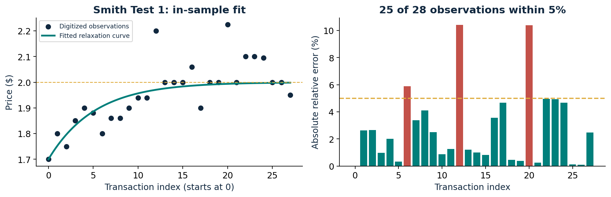

# The Physics in Economics

A physics-inspired study of market convergence through continuous double auctions, first-order relaxation and stochastic price dynamics.

By Aarush Shah · [Paper](paper/The_Physics_in_Economics.pdf) · [Interactive research explorer](docs/explorer.html) · [Source attribution](docs/UPSTREAM.md)

## Research contributions

- Built a continuous double-auction market simulator with five supply-demand environments and two initial regimes.
- Studied convergence across **750 seeded simulations** (75 runs per environment/regime cell).
- Fitted first-order relaxation to 28 digitized Smith Test 1 observations: **25/28 within 5% relative error**.
- Measured a maximum absolute terminal cell-mean offset of **0.8653% of equilibrium** across the simulated cells.
- Compared relaxation fit across geometries to characterize where a mechanical analogy captures the observed dynamics.

## Model evaluation

| Experiment | Measurement |
|---|---|
| Smith digitization, in-sample fit | Time constant 5.16585; R-squared 0.561401; 25/28 within 5% relative error |
| Monte Carlo design | 5 environments × 2 initial regimes × 75 seeds |
| Terminal convergence | Maximum absolute last-500 cell-mean offset: 0.8653% of equilibrium |
| Crossed-book sampling | 0 observed in sampled snapshots |
| Nonlinear surplus, exponential fit | R-squared -3.9708 |

The fit comparison makes model applicability a research question: convergence and exponential fit quality need not coincide. Smith results use the paper's digitized observations for in-sample fitting. Monte Carlo uses fresh deterministic seeds.

## Reproduce

~~~bash
python -m pip install -r requirements.txt
python verify.py
python run_mc.py --n-seeds 75
python analyze.py
python plot.py
~~~

Complete Monte Carlo before analysis. Use a fresh results/ directory when changing seed counts so file discovery uses the intended sample. Seeds are derived deterministically with SHA-256 and outputs use float64.

## Repository guide

- cda.py, environments.py: auction mechanism and supply-demand environments.
- run_mc.py, analyze.py, plot.py: simulation, analysis and figures.
- verify.py: Smith refit, equilibrium roots and seed checks.
- results/runs/: 750 simulation outputs.
- results/tex_data/ and verification/: fits, source tables and independent checks.
- paper/: original paper PDF.
- historical/: earlier experiments and TeX package, separately retained.

## Methods notes

The original paper is preserved. [Technical review](docs/AUDIT.md) records parameter conventions, the fixed 250-transaction analysis cutoff, relative-error normalization and the use of contract-price quantiles in the exploratory decomposition. These definitions support precise interpretation and further research.

[Earlier author visualization](https://physics-in-economics-tki6.vercel.app/) · [Upstream source](https://github.com/kongruene/The-Physics-in-Economics). Original attribution is retained; no new license is imposed on upstream material.
